<div align="center">


# ESP32 Smart Home

**A local web dashboard. A light sensor. A relay that brings them together.**

[](RelayNode) [](GatewayNode) [](GatewayNode/platformio.ini) [](#setup)

[](#architecture) [](#setup) [](#architecture) [](GatewayNode/web)

[](#verification) [](#verification) [](#verification) [](#hardware-test-record)

[Overview](#overview) · [Architecture](#architecture) · [Hardware](#hardware) · [Setup](#setup) · [Verification](#verification) · [Demo & records](#demo-and-records) · [References](#references)

</div>

> Validation badges summarize recorded checks for integration commit `df71770`, merged into `main` as `326a654`. They are static records, not live GitHub Actions results. Hardware outcomes were reported during the lab session on October 18, 2026.

<a id="overview"></a>

##  Built to work together

Control a relay from a local website, or let changing light conditions control it automatically. Three ESP32 nodes communicate over Bluetooth Mesh; the Gateway also joins Wi-Fi to serve the dashboard.

| Capability | What it does |
| --- | --- |
| Local web control | Send ON and OFF commands without navigating away from the dashboard. |
| Light automation | Darkness commands ON; brightness commands OFF when the LDR crosses its threshold. |
| Live relay feedback | Update the reported-state label from RelayNode responses, including sensor-driven changes. |
| Responsive controls | Preview the latest click with a Pending label; keep only the latest unsent intent during rapid clicks. |
| Monochrome dashboard | Light and dark themes, a glass-style layout, Inter typography, and Lucide SVG icons. |
| Saved Mesh membership | Restore provisioned settings after normal firmware uploads and power cycles. |
| Node identification | Light the selected node's external attention LED through Mesh attention events. |

### How web and sensor control interact

The last applied command controls the relay. A web command remains in effect while light stays in the same stable state. The sensor publishes its initial stable reading after startup, then publishes only when the light state changes.

| Action | Expected relay behavior |
| --- | --- |
| Press **Turn on** | ON |
| Press **Turn off** | OFF |
| Change from bright to dark | ON |
| Change from dark to bright | OFF |
| Leave light unchanged after a web command | Keep the web-commanded state |
| Restart RelayNode | Initialize its output to OFF |
| Restart SensorNode | Its initial stable reading can update the relay |

For example: keep the LDR bright, turn the relay ON from the website, then cover it. The relay stays ON. Uncover it into bright light and it turns OFF.

```mermaid
flowchart LR
    S["SensorNode<br/>Classic ESP32 · LDR input"]
    R["RelayNode<br/>Classic ESP32 · Relay output"]
    G["GatewayNode<br/>ESP32-S3 · Web + Mesh bridge"]
    B["Web browser<br/>Laptop or phone"]
    S -->|"Light-state publication · BLE Mesh"| R
    G -->|"ON / OFF command · BLE Mesh"| R
    R -->|"Reported state · BLE Mesh"| G
    B -->|"Web command · Local HTTP"| G
    G -->|"Page and live state events · Local Wi-Fi"| B
    classDef sensor fill:#191919,stroke:#b5b5b5,color:#f5f5f5
    classDef relay fill:#191919,stroke:#b5b5b5,color:#f5f5f5
    classDef gateway fill:#191919,stroke:#b5b5b5,color:#f5f5f5
    classDef browser fill:#191919,stroke:#b5b5b5,color:#f5f5f5
    linkStyle default stroke:#888888
    class S sensor
    class R relay
    class G gateway
    class B browser
```

<a id="architecture"></a>

##  System architecture



The phone app provisions and configures the Mesh network. Once configured, the nodes exchange Mesh messages without the phone acting as a command bridge. The dashboard's commands and locally hosted assets do not require an internet connection.

**State reporting:** RelayNode sends its current commanded state immediately after a web or sensor update, then schedules two additional reports 150 ms apart. A newer change restarts the short repeat burst, and each repeat reads the latest state. The Gateway also queries every two seconds as a fallback.

**Browser updates:** `/events` streams reported-state changes. If streaming is unavailable, the page falls back to `/status` polling. The Gateway allows two simultaneous streams; extra pages use the fallback. Pending button/glow previews are distinct from the confirmed reported-state heading.

> A relay report describes the firmware's commanded output. This project does not measure physical relay contact closure, load current, or lamp power. Wireless and browser scheduling can still introduce variable delay.

<a id="hardware"></a>

##  Hardware & connections

### Components

| Quantity | Component | Role |
| --- | --- | --- |
| 1 | ESP32-S3 development board, N16R8 | Gateway; Wi-Fi website and Mesh client |
| 2 | Classic ESP32 development boards | Relay and Sensor nodes |
| 1 | LDR comparator module with digital output | Light/dark threshold detection |
| 1 | Two-channel relay module | Channel 1 is used for the lab output |
| 3 | External LEDs with 220 Ω series resistors | Mesh attention / Identify indicators |
| As needed | USB data cables, jumper wires, and breadboards | Power, programming, and connections |

### GPIO map

| Node | Signal | Connection / behavior |
| --- | --- | --- |
| Gateway | Attention LED | GPIO4 → 220 Ω resistor → LED anode; cathode → GND |
| Relay | Attention LED | GPIO26 → 220 Ω resistor → LED anode; cathode → GND |
| Relay | Relay module IN1 | GPIO27; active LOW: LOW = ON, HIGH = OFF |
| Sensor | Attention LED | GPIO26 → 220 Ω resistor → LED anode; cathode → GND |
| Sensor | LDR digital output | DO → GPIO27; module VCC → 3V3; GND → GND |

Use the relay module's specified supply and a common ground with its controller. Keep the low-voltage control setup separate from any load wiring. The recorded functional checks do not establish mains-load switching performance.

Adjust the LDR module's potentiometer until its digital output switches reliably between the intended bright and covered conditions. The module's indicator LED is separate from the Mesh attention LED. The code uses the **digital threshold output**, not an analog lux measurement.

<details>
<summary><strong>Provisioned Mesh addresses and models</strong></summary>

These are addresses assigned by the phone for this tested setup, not universal defaults.

| Node | Primary address | Application models |
| --- | --- | --- |
| GatewayNode | `0x0008` | Generic OnOff Client |
| RelayNode | `0x0009` | Generic OnOff Server and Client |
| SensorNode | `0x0007` | Generic OnOff Server |

All nodes also include Configuration and Health servers. Bind the Lights AppKey to the Gateway client, both Relay OnOff models, and the Sensor OnOff server. The tested network uses NetKey index `0` and AppKey index `0`.

Configure the Sensor OnOff Server publication destination as `0x0009`, with its publication period disabled. The tested setup uses one publication retransmission at 100 ms. The firmware publishes on startup and stable light changes.

Peer constants live in [Common/BLE/lab_mesh_addresses.h](Common/BLE/lab_mesh_addresses.h). If a node is reset and reprovisioned with another address, update the peer constants and the phone's publication destination, then rebuild the affected nodes. Normal uploads do not require reprovisioning.

</details>

<a id="setup"></a>

##  Run the project

### 1. Open the complete repository

```powershell
git clone https://github.com/REGINE-BERMUDO/ESP32_Smart_Home.git
cd ESP32_Smart_Home
```

Keep `Common`, `GatewayNode`, `RelayNode`, and `SensorNode` together. Each node has its own `platformio.ini` and shares components from `Common`.

Use VS Code with PlatformIO. Select the node's folder as the PlatformIO project when building or uploading. The tested firmware uses the ESP-IDF framework; the project configuration uses the `espressif32` platform without a pinned platform version.

### 2. Configure Gateway Wi-Fi

Create **`GatewayNode/include/secrets.h`** locally:

```c
// Local configuration: do not commit real credentials.
#define WIFI_SSID "YOUR_2_4_GHZ_WIFI_NAME"
#define WIFI_PASSWORD "YOUR_WIFI_PASSWORD"
```

Use a 2.4 GHz access point. The tested arrangement used a laptop's 2.4 GHz mobile hotspot while its upstream Wi-Fi connection used 5 GHz. The browser must have a network route to the Gateway.

`secrets.h` is Git-ignored. Verify before sharing:

```powershell
git check-ignore GatewayNode/include/secrets.h
```

### 3. Build and upload

From the repository root, using a terminal where `pio` is available:

```powershell
pio run -d RelayNode
pio run -d SensorNode
pio run -d GatewayNode
```

Find the connected board's port:

```powershell
pio device list
```

Example upload and monitor for the Gateway:

```powershell
pio run -d GatewayNode -t upload --upload-port COM10
pio device monitor --port COM10 --baud 115200
```

Replace `GatewayNode` and the port for the board being programmed. The Gateway configuration currently names `COM10` and the Sensor configuration names `COM3`; these are local machine settings. Always identify the connected board rather than assuming the port. Close a serial monitor before uploading through the same port.

### 4. Provision and configure Mesh

For a new, unprovisioned board, use the nRF Mesh phone app to add the node, optionally Identify it, provision it, add the AppKey, and bind/configure the application models listed above. Keep the nodes in the same Mesh network.

For an already provisioned board, leave its saved membership in place. Its log should show a restored Mesh address. Deleting an entry only in the phone does not necessarily erase the node's saved provisioning state.

### 5. Open the dashboard

Read the Gateway serial log:

```text
gateway_wifi: Gateway IP: <assigned-address>
gateway_web: Web server started
```

Open **`http://<assigned-address>`** from your laptop or phone. Use the latest printed address; DHCP can change it. After uploading changed web assets, refresh with **Ctrl+F5** on desktop or reload the page on mobile.

The HTML, JavaScript, Inter font, and SVG icons are embedded in Gateway firmware. A separate frontend server or React build is not required.

<a id="verification"></a>

##  Verification results

### Software record

| Check | Recorded result | Coverage |
| --- | --- | --- |
| GatewayNode firmware build | Passed | ESP32-S3 Wi-Fi, Mesh, and embedded dashboard |
| RelayNode firmware build | Passed | Classic ESP32 relay control and state-report worker |
| SensorNode firmware build | Passed | Classic ESP32 LDR sampling and publication |
| Browser logic | 24 tests passed | Command ordering, pending previews, live reports, stale responses, timeouts, and themes |
| HTTP stream lifecycle | Passed | Stream capacity, allocation failures, state changes, heartbeat, and cleanup |
| LDR task | Passed | Stable startup, chatter filtering, change-only publication, and failed-send retry spacing |
| Relay state-report worker | Passed | Two bounded repeats, latest-state reads, newer-change coalescing, and startup failure |

The three native checks execute the relevant production source with simulated hardware or transport APIs. They do not simulate radio delivery or prove physical contact operation.

<details>
<summary><strong>Run the regression checks</strong></summary>

Browser logic requires Node.js:

```powershell
node --test GatewayNode/test/web_ui.test.cjs
```

Native checks require a host GCC/G++ compiler, separately from the ESP32 toolchain. From the repository root:

```powershell
g++ -std=c++17 -Wall -Wextra -Wno-unused-variable -I GatewayNode/test/host/include GatewayNode/test/host/test_stream.cpp -o "$env:TEMP/stream-test.exe"
& "$env:TEMP/stream-test.exe"

gcc -std=c11 -Wall -Wextra -Wno-unused-parameter -I SensorNode/test/host/include SensorNode/test/host/test_ldr.c -o "$env:TEMP/ldr-test.exe"
& "$env:TEMP/ldr-test.exe"

g++ -std=c++17 -Wall -Wextra -I RelayNode/test/host/include -I RelayNode/include RelayNode/test/host/test_state_reporter.cpp -o "$env:TEMP/state-report-test.exe"
& "$env:TEMP/state-report-test.exe"
```

Detailed test notes: [Gateway](GatewayNode/test/README.md) · [Sensor](SensorNode/test/README.md) · [Relay](RelayNode/test/README.md).

</details>

<a id="hardware-test-record"></a>

### Hardware test record

The following core results were confirmed during the lab session. Separate measurements and screenshots have not yet been added to the repository.

| Test | Expected behavior | Recorded outcome |
| --- | --- | --- |
| Web ON | Relay ON; reported state and glow settle to ON | Passed |
| Web OFF | Relay OFF; reported state and glow settle to OFF | Passed |
| Cover LDR from bright | Darkness commands ON | Passed |
| Uncover LDR into bright light | Brightness commands OFF | Passed |
| Combined web + sensor control | Web ON while bright; covering keeps ON; uncovering turns OFF | Passed |
| Node Identify / attention | Selected node's external attention LED lights | Reported working during setup |
| Perceived confirmation delay | State feedback follows relay operation promptly | Operator reported much smaller delay after report retries; no fixed latency guarantee |

**Recovery and endurance checks to record:** relay disconnect/reconnect, Wi-Fi interruption/recovery, multiple open pages, repeated reloads, and extended operation. These are acceptance scenarios, not completed-test claims. Follow the [full hardware checklist](docs/LIVE_STATE_TEST.md) and add the actual outcome and evidence after each test.

### Timing and state notes

| Mechanism | Implemented behavior |
| --- | --- |
| LDR sampling | Every 50 ms; four matching samples, approximately 150–200 ms of stability |
| Sensor publication retry | Failed attempts spaced by at least 500 ms |
| Sensor retransmission filtering | Relay ignores identical sensor publications received within one second |
| Relay feedback | Immediate status plus two repeats spaced 150 ms apart; repeats use current state |
| Gateway recovery query | Every two seconds, with a 1.5-second message timeout |
| Gateway report freshness | State becomes unavailable after six seconds without a fresh report |
| Web stream | Checks cached state every 100 ms; two-second heartbeat; maximum two streams |
| Browser recovery | Five-second stream silence detection and polling fallback |

These are configured intervals, not an end-to-end latency guarantee. **State unavailable means no fresh confirmation; it does not mean the relay is OFF.**


<details>
<summary><strong>HTTP endpoints and state semantics</strong></summary>

| Method | Path | Purpose |
| --- | --- | --- |
| GET | `/` | Embedded dashboard HTML |
| GET | `/app.js` | Local browser logic |
| GET | `/inter-latin.woff2` | Self-hosted Inter font for the Gateway website |
| GET | `/licenses.txt` | Dashboard font and icon notices |
| POST | `/on` | Request relay ON over Mesh |
| POST | `/off` | Request relay OFF over Mesh |
| GET | `/status` | JSON: `{"state":"on"}`, `{"state":"off"}`, or `{"state":"unknown"}` |
| GET | `/events` | Server-sent events carrying the same state object |

The dashboard sends command requests with `X-Requested-With: fetch`. A successful response means the Gateway accepted the Mesh send request; it is not relay confirmation. A Mesh setup/key error returns HTTP 503. Ordinary form submissions redirect back to `/`.

| Visible state | Meaning |
| --- | --- |
| Checking relay | The page is waiting for its first usable report. |
| Pending | The button/glow previews the latest request while confirmation is outstanding. |
| Relay is ON / OFF | The Gateway has a fresh response from RelayNode. |
| State unavailable | There is no fresh relay report; the output is not assumed OFF. |
| Request sent | The Gateway accepted the command for sending, independently of reported state. |

The browser serializes outgoing POSTs, replaces older unsent clicks with the latest intent, and ignores superseded HTTP responses. A pending preview settles when the requested state is reported or expires back to the latest reported state. Sensor messages continue to control the relay when a new stable light state occurs.

</details>

<details>
<summary><strong>Mesh messages, polarity, and startup sequence</strong></summary>

The Gateway uses Generic OnOff Set Unacknowledged for web commands and Generic OnOff Get for periodic verification. RelayNode's OnOff Server handles web commands and answers state queries. Its OnOff Client receives SensorNode's OnOff Status publications. Relay feedback is also sent as OnOff Status to the Gateway.

| Input / output | Logical value | Physical or application meaning |
| --- | --- | --- |
| LDR DO | HIGH (`1`) in the calibrated tested setup | Dark; publish ON |
| LDR DO | LOW (`0`) in the calibrated tested setup | Bright; publish OFF |
| Relay IN1 | LOW (`0`) | Active-low relay output ON |
| Relay IN1 | HIGH (`1`) | Relay output OFF |

Light/dark polarity is verified behavior for the module and calibration used here. If another module behaves differently, verify its DO level before changing firmware logic. LDR logic HIGH is not wired directly to relay IN1: the sensor publishes an application state, and RelayNode applies the active-low mapping.

Relay startup prepares IN1 HIGH, configures the output, restores Mesh membership, and initializes the commanded-state cache to OFF. The Sensor stabilizes its first reading before publishing. The Gateway restores Mesh membership, joins Wi-Fi, obtains an IP address, then starts its web server. Provisioning is enabled for boards that do not already have saved membership.

</details>

<details>
<summary><strong>Flash layout, logs, and upload notes</strong></summary>

The configured Gateway is an ESP32-S3 N16R8 with 16 MB flash and a 2 MB application partition. The Classic ESP32 Sensor configuration specifies 4 MB flash. Build each node with its own PlatformIO environment; sharing the `Common` folder does not make their firmware interchangeable.

Useful log messages include `Gateway IP`, `Web server started`, `Restored gateway Mesh membership`, `Restored SensorNode Mesh membership`, `Stable light published`, and `Relay reported state`. Some messages vary by node and initialization path. Bluetooth peer disconnect notices alone do not establish an application failure; correlate them with provisioning, command, and reported-state behavior.

After a normal update, preserve the existing network and AppKey configuration. If a node is intentionally reset or flash is erased, provision and configure it again and verify peer addresses. Do not erase flash as a routine response to a delayed status update.

See [the hardware acceptance checklist](docs/LIVE_STATE_TEST.md) for repeatable recovery and combined-control checks.

</details>

<a id="demo-and-records"></a>

##  Demo & project records

### Evidence to attach

| Record | What to capture | Status |
| --- | --- | --- |
| Complete setup | All three boards and their low-voltage connections | Photo to add |
| Node wiring | Gateway LED, relay IN1/LED, and LDR DO/LED connections | Photos to add |
| Dashboard | Light/dark themes and confirmed ON/OFF states | Screenshots to add |
| Provisioning | Node list, model bindings, and sensor publication destination | Screenshots to add; redact Mesh keys |
| Functional demo | Web ON/OFF followed by covered/uncovered LDR behavior | Recording to add |
| Recovery results | Actual outcomes for the remaining acceptance checks | Record after testing |

Add real photos, screenshots, and small clips under `docs/media/`, then replace the record status with a relative file link. For a larger recording, use a shared video or GitHub-hosted attachment link. Do not include passwords, private network details, or Mesh keys in screenshots.

The README artwork is a presentation graphic, not a photograph of the tested hardware. The reserved media entries above do not claim to contain evidence that has not been added.

### Repository map

```text
ESP32_Smart_Home/
+-- Common/
|   +-- BLE/                  Shared Mesh helpers and peer addresses
|   +-- LED/                  Shared attention LED component
+-- GatewayNode/
|   +-- include/              Headers and local, ignored secrets.h
|   +-- src/                  Mesh client, Wi-Fi, HTTP server, startup
|   +-- web/                  HTML, JavaScript, Inter font, icon licenses
|   +-- test/                 Browser and native stream checks
+-- RelayNode/
|   +-- include/
|   +-- src/                  Relay control, sensor reception, state reports
|   +-- test/                 Native state-report worker check
+-- SensorNode/
|   +-- include/
|   +-- src/                  LDR sampling and Mesh publication
|   +-- test/                 Native LDR task check
+-- docs/
    +-- assets/               Approved silver-house banner, monochrome logo badges, icons, and credits
    +-- LIVE_STATE_TEST.md    Setup notes and hardware acceptance checklist
```

### Development record

The project grew through relay control and initial Gateway work, LDR sensor
integration, then combined testing of web control, sensor commands, and live
state feedback. The final integration is available on **`main`**.

Integration commit: **`df71770`**. Merge into `main`: **`326a654`**.
Use the repository's Git history for the implementation record and
[GitHub's contributor history](https://github.com/REGINE-BERMUDO/ESP32_Smart_Home/graphs/contributors)
for authorship. Earlier feature branches preserve development versions.

<a id="troubleshooting"></a>

##  Troubleshooting

<details>
<summary><strong>The website cannot be reached</strong></summary>

Check that the Gateway is powered and has printed an IP address and the web-server startup message. Use `http://` and the latest address. Check your laptop/phone can reach the same local network and that the access point permits communication between clients.

```powershell
Test-NetConnection <gateway-ip> -Port 80
```

A local laptop hotspot worked in the tested setup when the original network could not reach the Gateway reliably. A successful build or upload does not prove network reachability.

</details>

<details>
<summary><strong>The website shows State unavailable</strong></summary>

Keep RelayNode powered. Check its saved Mesh membership, current address, and Lights AppKey bindings. Verify [peer constants](Common/BLE/lab_mesh_addresses.h) match the phone's addresses. Look for `Relay reported state` in the Gateway log. Do not interpret unavailable as a confirmed OFF state.

</details>

<details>
<summary><strong>The LDR changes but the relay does not</strong></summary>

Check 3V3, common GND, and DO → GPIO27; calibrate the module's threshold. Confirm the sensor's Generic OnOff Server is bound to Lights and publishes to RelayNode's current address. The Sensor log records `Stable light published: dark / ON` or `bright / OFF` after accepted publications. Accepted sending is not proof of delivery.

</details>

<details>
<summary><strong>A web command changes again after using the sensor</strong></summary>

A new stable light change is another relay command and can replace the last web command. This is expected. Keep light steady when testing a manual command. The sensor's first stable reading after a restart can also update the output.

</details>

<a id="references"></a>

##  References & credits

- **Learning material:** [Espressif ESP-IDF BLE Mesh components](https://github.com/espressif/esp-idf/tree/master/components/bt/esp_ble_mesh).
- **Project reference:** [Internet of Things with ESP32 — Chapter 9](https://github.com/PacktPublishing/Internet-of-Things-with-ESP32/tree/main/ch9).
- **Relay module tutorial:** [ESP32 relay module and web server](https://randomnerdtutorials.com/esp32-relay-module-ac-web-server/).
- **Relay module datasheet:** [Handson Technology two-channel relay module](https://www.handsontec.com/dataspecs/2Ch-relay.pdf).
- **LDR module reference:** [ESP32 LDR module](https://esp32io.com/tutorials/esp32-ldr-module).
- **Dashboard assets:** Inter font and Lucide SVG icon attribution is included in [GatewayNode/web/licenses.txt](GatewayNode/web/licenses.txt).
- **README graphics:** The original silver-house banner is preserved. Badges use real Inter letter shapes, Simple Icons technology marks, and Lucide symbols. See [source and rebuild notes](docs/assets/README.md), [Inter notice](docs/assets/INTER-LICENSE.txt), and [Lucide license](docs/assets/sources/lucide/LICENSE), and [technology-logo source and license](docs/assets/sources/simple-icons/source.json).

<details>
<summary><strong>README typography and rendering</strong></summary>

GitHub controls the font used for normal README text. Custom badges preserve actual Inter typography by drawing shaped letters as SVG paths. The original black-and-white banner is kept unchanged. Body documentation remains native Markdown so it stays searchable, selectable, and usable with assistive technology.

Technology badges use monochrome Espressif, PlatformIO, Bluetooth, C++, HTML5, CSS, and JavaScript marks from Simple Icons. Lucide supplies generic Wi-Fi, section, and verification symbols. SVG assets work directly in GitHub without running React. The silver glow, reflections, and glass-style highlights are static SVG effects, with no animation or script dependency. Each badge has a text alternative, and verification results remain written out in the tables.

</details>

---

<div align="center">

**ESP32 Smart Home** · Local control · Bluetooth Mesh · Light automation

[Back to top](#esp32-smart-home)

</div>
